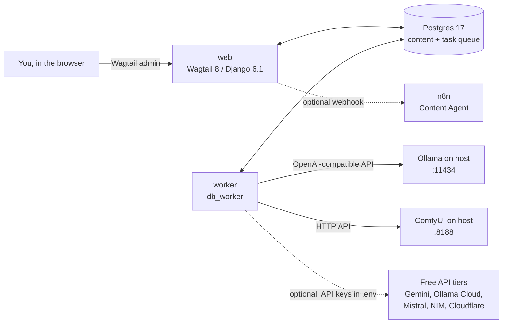

# Architecture

## Overview

The GPU and large models stay on the Windows host. Containers reach them at `host.docker.internal`. This avoids GPU passthrough into Docker and lets Ollama use the host's 64 GB of RAM for models larger than the 8 GB of VRAM.

## Components

| Component | Location | Responsibility |
|---|---|---|
| Settings | `config/settings/{base,dev,production,test}.py` | Environment-driven configuration. Secrets only from env vars. |
| Content Studio | `apps/studio/` | Admin menu, overview, briefs, runs, approvals and the pipeline engine (M3–M4) |
| AI layer | `apps/ai/` (M2) | Provider registry. One OpenAI-compatible client for all text providers; image providers for ComfyUI and Cloudflare. |
| Quality checks | `apps/quality/` (M5) | Readability, AI-tell scans, hidden-Unicode cleaning, SEO checks. These wrap the user's existing skill scripts. |
| Content | `apps/content/` (M7) | `ArticlePage`, the published destination for approved output |
| Home, search | `apps/home/`, `apps/search/` | Wagtail starter apps (public site root and search) |

## Request and job flow

1. You create a **brief** and start a **run** in the admin (`web`).
2. `web` enqueues the first step as a task in Postgres (`django-tasks-db`).
3. `worker` picks it up, renders the prompt, calls the configured provider, runs the quality checks and stores the output.
4. If the step has an approval gate, the run waits. When you approve (or edit and approve), `web` enqueues the next step.
5. The final step creates an `ArticlePage` draft, which goes through Wagtail's moderation workflow.

## Background tasks

Django 6.1 ships a task framework (`django.tasks`). Wagtail 8 still enqueues through the `django_tasks` backport. Both read the same `TASKS` setting. With `django_tasks_db.DatabaseBackend`, Wagtail's tasks (reference index, search index) and the studio's tasks share one Postgres queue and one `worker`. This was verified in M1 by publishing a page and watching the worker complete both Wagtail tasks. See [ADR 0002](adr/0002-django-tasks-db.md).

## Security notes

- `.env` is git-ignored. API keys are read from the environment at call time and never stored in the database.
- Production settings require `DJANGO_SECRET_KEY` and restrict `ALLOWED_HOSTS`.
- The admin is the only interactive UI and requires login.
- Free API tiers may use prompts for training, so never send confidential material to them (see [providers.md](providers.md)).
