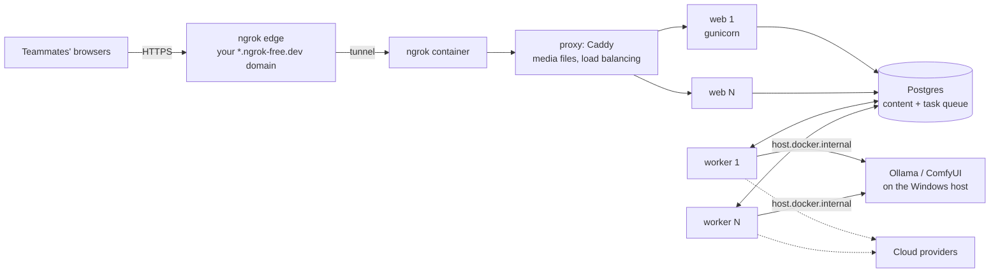

# Deployment: sharing the studio and scaling it

The studio has two run modes. They use the same containers, database and images, so switching keeps all data; run one at a time.

| Mode | Command | Use |
|---|---|---|
| **Dev** | `docker compose up -d` | Working on the code: runserver with live reload, `DEBUG` on, port 8000 |
| **Share** | `docker compose -f docker-compose.yml -f docker-compose.share.yml up -d --build` | Letting other people use it: gunicorn, `DEBUG` off, secure cookies, Caddy in front, an ngrok HTTPS tunnel |

Switch with `docker compose down` (or the same `-f` flags with `down`), then the other mode's command.

## How the shared stack fits together



- **ngrok** terminates HTTPS and forwards to Caddy. Its request inspector is at http://localhost:4040 (local only).
- **Caddy** (`deploy/Caddyfile`) serves uploaded and generated images from the media volume and spreads all other requests over every running `web` container. It re-resolves the service name every 10 seconds, so scaled replicas join automatically.
- **web** runs gunicorn (`GUNICORN_WORKERS`, default 3 processes per container) with production settings. Static files come from WhiteNoise.
- **worker** runs pipeline steps. Several workers can share the queue: each task is claimed with `SELECT … FOR UPDATE SKIP LOCKED`, and a step is only run while it's still queued.
- A local check without the tunnel: http://localhost:8080/admin/.

## Set up sharing (once)

1. **ngrok account and agent.** If the Windows ngrok agent already works (`ngrok config check` says "Valid configuration file"), reuse its config: put the path that command prints in `.env`. The Microsoft Store build keeps the file in a redirected folder; `ngrok config check` shows the logical path, and the real file is under `%LOCALAPPDATA%\Packages\ngrok.ngrok_…\LocalCache\Local\ngrok\ngrok.yml`:

   ```
   NGROK_CONFIG_FILE=C:/Users/<you>/AppData/Local/Packages/ngrok.ngrok_<id>/LocalCache/Local/ngrok/ngrok.yml
   ```

   Otherwise set `NGROK_AUTHTOKEN` from https://dashboard.ngrok.com/get-started/your-authtoken. The token stays in your file; it's never in git.
2. **Domain.** Free accounts get one static dev domain (shown under **Domains** in the ngrok dashboard), and the agent uses it automatically. Set `NGROK_DOMAIN` only to use a different reserved domain.
3. **Public URL.** Set `STUDIO_PUBLIC_URL=https://<your domain>` so links the studio builds (webhook `admin_url`, notifications) use it. The URL is shown in the ngrok logs: `docker compose logs ngrok`.
4. **Accounts for teammates.** In Wagtail, **Settings › Users › Add a user**. Give writers and editors the **Editors** group and moderators the **Moderators** group. Until M8 adds studio permissions, any user who can open the admin can use every Content Studio screen.
5. Start the share mode (command above) and send people the URL.

The first visit on a free ngrok domain shows ngrok's "You are about to visit" page; click **Visit Site** once. Free plans have bandwidth and request limits; check yours in the ngrok dashboard.

## Security in share mode

- The admin login is on the public internet. Use long, unique passwords; there's no login rate limiting until M8.
- `DEBUG` is off, cookies are `Secure`, and Django trusts `X-Forwarded-Proto` only because Caddy accepts it solely from the Docker network.
- Accepted deployment-check warnings: no HSTS (the ngrok domain is shared and temporary), no forced HTTPS redirect (the local `:8080` check stays usable), and `X_FRAME_OPTIONS = SAMEORIGIN` (Wagtail's preview needs it).
- Images in `/media/` are public by URL, as in any Wagtail site. That includes heroes of drafts.
- Only the proxy (`127.0.0.1:8080`) and the ngrok inspector (`127.0.0.1:4040`) listen on the host, and only locally. Ollama and ComfyUI stay unreachable from outside.
- Stopping the `ngrok` container (`docker compose -f docker-compose.yml -f docker-compose.share.yml stop ngrok`) takes the studio off the internet immediately.

## Scaling

### Now, on one machine

```bash
docker compose -f docker-compose.yml -f docker-compose.share.yml up -d --scale web=2 --scale worker=2
```

| Part | Scales by | Limit to watch |
|---|---|---|
| web | `--scale web=N`, `GUNICORN_WORKERS` | CPU and RAM; it's stateless (sessions in Postgres) |
| worker | `--scale worker=N` | Provider limits: more workers mean more parallel model calls, which hit free-tier rate limits sooner. Local models run one at a time on the 8 GB GPU anyway (`OLLAMA_MAX_LOADED_MODELS=1`) |
| Postgres | Single instance | Fine for a team; it also holds the task queue |
| Media | One Docker volume shared by web, worker and Caddy | Single machine only |

### Later, beyond one machine

The design keeps state in two places only (Postgres and media), so moving to several machines or a cloud host is mostly configuration ([ADR 0005](adr/0005-containerised-sharing-and-scaling.md)):

1. **Media to object storage** (S3-compatible, e.g. Cloudflare R2 or MinIO) with `django-storages`, so any web or worker container can read and write images.
2. **Managed Postgres** (or a dedicated database host) with backups.
3. **A real domain with TLS** instead of ngrok: Caddy can get certificates itself (`auto_https`), or a cloud load balancer sits in front.
4. **Containers on a scheduler** (Docker Swarm, Kubernetes or a container platform) running the same images; web and worker scale independently.
5. **Models:** cloud providers scale with their quotas; local Ollama and ComfyUI remain one GPU host that the workers call over the network.

## Everyday commands (share mode)

Set an alias to save typing, for example in PowerShell: `function share { docker compose -f docker-compose.yml -f docker-compose.share.yml @args }`.

| Task | Command |
|---|---|
| Start or update | `share up -d --build --scale web=2 --scale worker=2` |
| Public URL | `share logs ngrok` (look for `url=`) or http://localhost:4040 |
| Logs | `share logs -f web worker proxy` |
| Take it offline | `share stop ngrok` |
| Back to dev mode | `share down`, then `docker compose up -d` |
