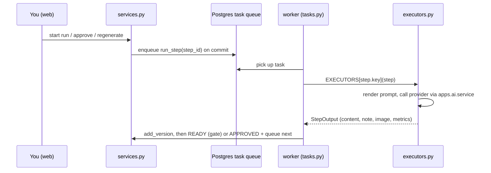

# Development guide

For developers and AI coding agents (Claude Code, Codex and others). The rules agents must follow are in [AGENTS.md](../AGENTS.md); this guide explains the code and the change process. Start a new session by reading [HANDOFF.md](HANDOFF.md).

## Code map

| Path | What's there |
|---|---|
| `config/settings/` | `base.py` (apps, providers, `AI_PROFILES`, studio settings), `dev.py`, `production.py`, `test.py` |
| `apps/studio/` | Content Studio: models (`ContentBrief`, `BriefPreset`, `GenerationRun`, `StepRun`, `StepVersion`, `MetadataOption`), `pipeline.py` (steps per content type), `executors.py` (what each step does), `tasks.py` (worker entry point), `services.py` (state changes), `permissions.py` (roles and who may act on which step), `prompting.py` + `prompts/*.md` (prompt templates), views and templates, `wagtail_hooks.py` (menu, URLs, badge, group permissions) |
| `apps/ai/` | Provider layer: `providers.py` (registry from settings), `service.py` (`generate`, `generate_image`, retries), `adapters/` (OpenAI-compatible, Ollama native), `images/` (Cloudflare, ComfyUI), `catalog.py` (models offered in dropdowns), `checks.py` (provider checks), `redact.py` (removes secrets from errors and logs), `evaluation/` + `eval_models` / `eval_report` commands |
| `apps/quality/` | Vendored skill scripts (`vendor/`, unchanged copies) and their wrappers: `scripts.py` (runs scanners via `--json`), `scans.py` (quality badges), `review.py` (the seven-part review sequence), `hero.py` (hero branding) |
| `apps/content/` | `ArticleIndexPage`, `ArticlePage`, `markup.py` (Markdown → sanitised HTML and StreamField blocks), `publishing.py` (draft + moderation + webhook), `exports.py` (Markdown, HTML, DOCX, WebP) |
| `apps/home/`, `apps/search/` | Wagtail starter apps |
| `eval/` | Evaluation briefs, candidates and prompts; `eval/runs/` is git-ignored |
| `comfyui/workflows/` | ComfyUI workflows exported in API format |
| `frontend/` | The step-output editor (Tiptap 3 + `@tiptap/markdown`, vanilla JS, esbuild): `src/schema.js` (extensions shared by browser and tests), `src/nodes.js` (dialect nodes: anchored headings, Wagtail images, embeds, FAQ, `[VERIFY]`), `src/editor.js` (toolbar, Visual/Markdown, autosave), `test/` (vitest round trips over `tests/fixtures/dialect/`). Bundles to `apps/studio/static/studio/editor/` (git-ignored) |
| `tests/` | pytest-django tests, one file per area |
| `docs/` | Guides, architecture, ADRs, roadmap, handoff |

## How a step runs



`execute_step` only picks up a step whose status is `queued`, so a duplicate task is harmless. Executors raise `StepError` for problems the user can fix and `ProviderError` for provider failures; both become a plain-language message on a Failed step. Anything else is logged and shown as "Unexpected error".

## Conventions (summary of AGENTS.md)

- Everything runs in Docker; never install packages on the host Python. Pin dependencies exactly and check they resolve in the container.
- Extend Wagtail through hooks, viewsets and components; never patch Wagtail.
- Long work (LLM calls, images) runs as tasks in the worker, never in a request.
- Steps use a **profile**, never a hard-coded provider or model.
- Secrets only from environment variables.
- Every behaviour change comes with tests and a doc update; significant decisions get an ADR in `docs/adr/`.
- `ruff check` and `ruff format` clean, line length 110. Vendored scripts are excluded from ruff and must stay byte-identical to the skills.
- Model output is untrusted: render it through `apps.content.markup.markdown_to_html` (Markdown + nh3), never `|safe` on raw text.
- **Permissions:** every studio view sets `permission_required` (and `post_permission` for actions) from `apps/studio/permissions.py`; every run-workspace action goes through `permissions.can_act`. Hiding a button is not enough.
- Text that might contain provider output or errors is stored through `ProviderError` or `apps.ai.redact.redact`, so keys and account IDs never reach the database or logs.

## Everyday commands

| Task | Command |
|---|---|
| Tests | `docker compose exec web pytest` |
| One test file | `docker compose exec web pytest tests/test_publish.py -q` |
| Lint and format | `docker compose exec web ruff check .` and `docker compose exec web ruff format .` |
| Migrations | `docker compose exec web python manage.py makemigrations` (commit them) |
| Example data | `docker compose exec web python manage.py studio_demo` |
| Shell | `docker compose exec web python manage.py shell` |
| Pick up code changes in the worker | `docker compose restart worker` |
| Editor bundle | Rebuilt automatically by the dev `frontend` service (`docker compose logs frontend`); by hand: `cd frontend && npm ci && npm run build` |
| Editor tests | `cd frontend && npm test` (or `docker compose exec frontend npm test`) |
| Long evaluation runs | `docker compose run --rm --no-deps -T web python manage.py eval_models …` (a one-off container survives dev-server reloads) |

## Testing patterns

- Tests always use `config.settings.test` (`--ds` in `pyproject.toml`): DummyCache, `STUDIO_EXECUTE_STEPS=False` (no task enqueueing; tests call `execute_step` directly), `STUDIO_QUALITY_SCANS=False`.
- **No real provider calls in tests.** Patch `executors.generate` / `executors.generate_image` with fakes (see `FakeLLM` in `tests/test_pipeline.py`), mock raw HTTP with `respx`, and for the openai SDK inject a mock transport through `openai_compat.http_client_factory` (the SDK bundles its own httpx fork that respx can't see).
- Hero branding tests copy the vendored scripts into a temp folder with generated placeholder assets (`vendor` fixture in `tests/test_images.py`), so CI never needs the real logo.
- Publishing tests build an approved run with `_approve()` in `tests/test_publish.py`.
- Role tests log in users from the real groups (`_user(name, "Writers")` in `tests/test_permissions.py`); most other tests use `admin_client`, a superuser.

## How to…

### Change a prompt

Edit `apps/studio/prompts/<step>.md`. Templates have `## system` and `## user` sections and `{{placeholders}}` filled from `prompting.context_for()` (brief fields, approved earlier outputs, the regenerate note). Restart the worker afterwards. When a prompt mirrors a skill, check it against the skill in `~/.claude/skills/` (CLAUDE.md asks for this).

### Add a pipeline step

1. Add a `StepDef` to `STEPS` in `apps/studio/pipeline.py` and put its key in the right `PIPELINES` lists.
2. Write an executor in `apps/studio/executors.py` returning a `StepOutput`, and register it in `EXECUTORS`.
3. Add a prompt template if it calls a model; give it a `MAX_TOKENS` entry (reasoning models spend tokens before answering).
4. Add tests (executor with fake providers, and a view test if the run screen changes) and update `docs/workflow.md`.

### Add a model or provider

- **A model from an existing provider:** add a `CatalogModel` to `apps/ai/catalog.py` with its status (`free`, `limited`, `paid`, `unavailable`) and any options. Verify it's actually free first.
- **A provider with an OpenAI-compatible API:** add it to `AI_PROVIDERS` in `config/settings/base.py` with `api_key_env`, add the key to `.env.example`, and add a check model in `apps/ai/checks.py`.
- **A new API shape:** write an adapter in `apps/ai/adapters/` (text) or `apps/ai/images/` (images) that returns `GenerationResult` / `ImageResult` and raises `ProviderError` with the right `kind` (retryable kinds: `rate_limited`, `server`, `network`), then register it in `TEXT_ADAPTERS` / `IMAGE_ADAPTERS` in `apps/ai/service.py`.
- Changing which model a step uses by default means changing `AI_PROFILES`; do that from evaluation results ([model-eval.md](model-eval.md)).

### Change the editor

The editor bundle is built three ways: the Dockerfile's `frontend` stage (images), the dev compose service `frontend` (`npm run watch` into the bind mount; esbuild polls, so it works on Windows), and `npm run build` by hand. Packages are pinned exactly in `frontend/package.json` with a committed lock file; pick versions at least two weeks old.

- A new Markdown construct needs a node in `frontend/src/nodes.js` (with `markdownTokenizer`, `parseMarkdown`, `renderMarkdown`), the matching Python in `apps/content/dialect.py`, a line in ADR 0007, and a case in `frontend/test/roundtrip.test.js`.
- `@tiptap/markdown` HTML-encodes `&`, `<` and `>` in all text; `PlainTextEncoding` in `schema.js` replaces that with minimal encoding. Python-Markdown is told about `\~` and `\+` escapes and unescapes caption quotes, so both sides read what the other writes.
- The textarea holds the Markdown that is posted; the visual editor writes back only after a visual change. Saving posts `base_version`; `services.save_edit` / `approve_step` refuse it if a newer version exists.
- Wagtail's `core.css` gets in the way in places (`:focus-visible` outline with `!important`, `form li { list-style: none }`); `editor.css` overrides those explicitly.
- CI job `frontend`: `npm test`, `npm run build`, and a 250 KB gzip budget for `editor.js` (about 170 KB now).

### Editor endpoints and choosers (phase 5)

- `apps/studio/views/editor_api.py`: `POST studio/editor/images/` (through Wagtail's image form, so types and the 10 MB limit apply; needs studio access and Wagtail's add-image permission), `GET studio/editor/refs/?image=&page=&document=` (previews and titles, also embedded in the page as `editor-refs`), `GET studio/editor/embed/?url=` (`wagtail.embeds`, limited to YouTube and Vimeo by `WAGTAILEMBEDS_FINDERS`). The editor sends the form's CSRF token.
- The workspace loads Wagtail's `page-chooser-modal.js`, `image-chooser-modal.js` and `document-chooser-modal.js`; `frontend/src/wagtail.js` opens them with `new XChooserModal(url).open(options, callback)` (the page chooser needs `modelNames`).
- In the built-in browser pane, `<dialog>` close events and animation frames don't fire; `formDialog` finishes on submit, cancel or `close()` itself, so the flows work there and in real browsers.

### Provider keys (ADR 0008)

`apps/ai/secrets.py` (Fernet under `STUDIO_SECRETS_KEY`), `apps/ai/models.py` (`ProviderConfig`, `AddedModel`), `apps/ai/providers.py` (stored key over `.env`), `apps/ai/catalog.py` (`all_models()` merges added models; use it, not `CATALOG`, wherever models are listed), views in `apps/studio/views/provider_keys.py`. Registry tests need the database (`pytestmark = pytest.mark.django_db`).

### Change the article page

Blocks live in `apps/content/models.py` (`ARTICLE_BLOCKS`); the Markdown conversion that fills them is `apps/content/markup.py::to_stream`. Change both together, run `makemigrations`, and update `tests/test_publish.py`.

### Add an export format

Add a builder to `apps/content/exports.py` (use `article_content()` and `article_meta()`), register the format in `EXPORTS` and `run_export` in `apps/studio/views/runs.py`, and add it to `_export_links`.

### Update the vendored skill scripts

Copy the new files from `~/.claude/skills/<skill>/scripts/` over `apps/quality/vendor/<folder>/` without editing them, run the tests, and commit. See [operations.md](operations.md#updating-the-vendored-skill-scripts) for the folder map.

### Requeue a stuck or approved step

A step stuck in **Running** after a worker restart: an operator uses **Mark as failed** on the step, then **Retry**. The UI also requeues failed steps (Retry), steps with a model (Regenerate) and model-less steps waiting for review (Run again). To rerun an already approved step, from `docker compose exec web python manage.py shell`:

```python
from django.db import transaction
from apps.studio import services
from apps.studio.models import StepRun

step = StepRun.objects.get(run_id=9, key="publish")
with transaction.atomic():
    step.status = StepRun.Status.QUEUED
    step.save()
    services.enqueue(step)
services.refresh_run_status(step.run)
```

## Change and release process

1. **Plan** against [roadmap.md](roadmap.md); larger work follows its milestone.
2. **Build** with tests and docs in the same change. Verify behaviour live where it matters (the milestones so far were each checked on a real run, recorded in the roadmap).
3. **Check** locally: `ruff check .`, `ruff format --check .`, `pytest`, and `makemigrations --check` for model changes.
4. **Commit** to `main` (single-maintainer project) with a message that says what changed and why. Commits by Claude Code end with its `Co-Authored-By` line. Agents commit and push only when the user asks.
5. **CI** (GitHub Actions, `.github/workflows/ci.yml`) runs lint, format, Django checks, the migration check and the tests against Postgres, and builds the production image. Keep it green.
6. **Hand off:** update [HANDOFF.md](HANDOFF.md) (state, next steps, gotchas) at the end of a session, so the next person or agent can start from it.

## Decisions to know about

| ADR | Decision |
|---|---|
| [0001](adr/0001-wagtail-admin-shell.md) | The Wagtail admin is the app shell |
| [0002](adr/0002-django-tasks-db.md) | Background work uses `django-tasks-db` in Postgres, one worker |
| [0003](adr/0003-provider-registry.md) | One OpenAI-compatible client, profiles, free providers only, Ollama native API for local models |
| [0004](adr/0004-brand-assets-outside-git.md) | Hero brand assets stay outside git |
| [0005](adr/0005-containerised-sharing-and-scaling.md) | Share mode behind Caddy and ngrok; stateless web and workers that scale out |
| [0006](adr/0006-roles-and-login-protection.md) | Four studio roles as Wagtail groups; login rate limiting with django-axes |

Other standing decisions: free models only (no paid APIs, no Claude API); model defaults come from blind evaluation on real briefs; local-first where the hardware allows.
