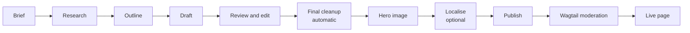

# User guide: producing content in the studio

For writers, editors and moderators. It covers the whole process from brief to published page. For the overview of every tool and process, see [tools-and-processes.md](tools-and-processes.md).

## What the studio does

The studio runs the same steps as the Claude Code content skills (research, outline, draft, edit, cleanup, hero image, localise, publish), using AI models in the background. **Every step stops for your approval** before the next one starts, and whatever you approve, including your own edits, is what the next step works from. Nothing reaches the website without passing Wagtail's moderation workflow.

Guest posts add a **Site crawl** step before research, which profiles the target site's voice and format.

## Getting in

Log in at `http://localhost:8000/admin/` (or the address your operator gives you) and open **Content Studio** in the sidebar. The sidebar badge counts steps waiting for your review.

| Screen | Use it to |
|---|---|
| **Content Studio** (dashboard) | See what needs your review, what's running, what finished recently, and whether Ollama and ComfyUI are reachable |
| **Briefs** | Find, edit and reuse briefs; start a new run from an existing brief |
| **New brief** | Write a brief and start a run |
| **Runs** | All runs, filterable by status |
| **Presets** | Saved brief defaults per content type |
| **Models and providers** | Which models are available, free or paid, and the result of the last provider check |

### What your role lets you do

Your account is in one of four groups, set by an admin:

| Group | You can |
|---|---|
| **Writers** | Write briefs and start runs; approve, edit or regenerate site crawl, research, outline and draft; choose title, meta description and slug |
| **Editors** | Everything writers can, plus review and edit, final cleanup, hero image, localise, publish, and downloads |
| **Moderators** | Read every run; approve and publish pages in Wagtail |
| **Operators** | Read every run; re-check providers, manage presets, and mark a stuck step as failed |

Screens and buttons you can't use are hidden. If a step is waiting for someone else's role, it says so, for example "Ready for review by editors".

Passwords need at least 12 characters. After 5 wrong passwords, sign-in for your username pauses for 15 minutes; an operator can unlock it sooner.

## 1. Write a brief

Open **New brief**. Start from a preset if one fits (for example "SDS Manager blog · US · FKGL 9"); it fills the defaults, including a model per step.

| Field | What to enter |
|---|---|
| Content type | SEO blog (sdsmanager.com, including pillar pages), guest post, lead magnet or whitepaper |
| Topic | What the piece is about, in plain words |
| Primary keyword | Goes in the title, the first 100 words and two or three headings |
| Secondary keywords | One per line or comma-separated; each is used once where it fits |
| Region | Sets spelling, regulations and the authority cited (US OSHA, UK HSE/COSHH, AU, CA WHMIS, NZ, EU REACH/CLP) |
| Reading grade (FKGL) | Soft target, checked per section during Review and edit |
| Target length | A guide, not a quota |
| Audience, reader's expertise | Who reads it and how much they already know |
| Call to action | Subtle link, button, or none |
| Target site, URL, narrative mode | Guest posts only. The site crawl proposes the narrative mode |
| Anchors, brief source | Guest posts only. One anchor per line as `anchor text | https://product-page`, in the sheet's order; and where the brief came from (e.g. "Guest Post Plan, row 14") |
| Localise to | Only if you want the optional Localise step: the region of the variant |
| Notes | Anything the models should know: angle, sources to use, things to avoid, the host's requirements for a guest post |

Then choose how the run proceeds:

- **Review each step** (default): every step waits for your approval. Tick **SOP self-review** on any step you still want checked and revised by the reviewer model before you see it.
- **Autopilot (one-shot)**: every text step is checked against the house SOP by the reviewer model and revised by its own model until it passes (up to three revisions). The run stops only where a step can't pass (it shows the open findings), where Final cleanup finds `[VERIFY]`, `[SRC:]` or `[VISUAL:]` markers, or at a step whose approval box you left ticked (the hero image by default). Publish still creates a draft page for Wagtail moderation; nothing goes live on its own. The rules it checks are in [sop.md](sop.md).

Then the steps (Hero image and Localise are optional), the model for each step, and the approval boxes. **Start run** queues the first step; **Save** keeps the brief for later; the briefs list has **Start run** and **Autopilot** buttons for saved briefs. **Save current as preset** stores the settings for next time.

**Don't put confidential information in a brief.** Some models run on free cloud tiers that may use prompts for training. Public-facing article material is fine; customer data, unpublished commercial plans and internal figures aren't.

## 2. Follow a run

The run workspace has three columns:

- **Left:** the step timeline with a status for each step (Waiting, Queued, Running, Ready for review, Approved, Failed, Skipped).
- **Centre:** the selected step's output, its version, and the model that produced it.
- **Right:** checks for that output, the model dropdown to regenerate, and the version history.

Steps run in the background. A local model can take 20 minutes on a draft; the page shows the elapsed time against the model's typical duration and refreshes itself. You can leave: when a step is ready, a message appears on your next admin page, the sidebar badge goes up, and the run appears under **Needs your review** on the dashboard.

## 3. Review a step

| Action | What it does |
|---|---|
| **Approve** | Accepts the output and queues the next step |
| **Edit** | Opens the text in the editor (below). **Save as new version** keeps the step waiting for review; **Save and approve** saves and approves in one go. Your version is what later steps use |
| **Regenerate** | Runs the step again with the model you pick, plus an optional note for that attempt (for example "add a section on state plans") |
| **Reject run** | Stops the run and records your reason |
| **Retry** | On a failed step: runs it again with the same model |
| **Run again** | On Final cleanup and Publish (they have no model): runs the step again |
| **Compare** | Shows what changed between two versions, word by word or as it will look (see below) |

### Editing text

**Edit** swaps the step's text for an editor with a toolbar: text style (paragraph, heading 2–4), bold, italic, underline, strikethrough, links, bulleted and numbered lists, quotes, tables, FAQ blocks and dividers. Selecting text shows a small menu for the common marks. Shortcuts: Ctrl+B, Ctrl+I, Ctrl+U, Ctrl+K (link), Ctrl+Z / Ctrl+Shift+Z.

- **Visual / Markdown** switches between the editor and the Markdown underneath. Both edit the same text; nothing is lost when you switch.
- Claims to check show as a **VERIFY** chip. Images from the library show with their alt text and caption: double-click one (or use the image button) to change the alt text, mark it decorative, or edit the caption. Alt text is required unless the image is decorative.
- **Links** (Ctrl+K or the link button) can go to a web address, a **page on this site** or a **document** (picked in Wagtail's own chooser), a **heading in the same text**, an email address or a phone number. Headings with a fixed anchor show it as a small `#name` tag.
- **Images**: the image button inserts one from the image library (Wagtail's chooser, with its search and upload tabs) or uploads one from your computer. You can also **drag images into the text or paste them**. Each new image asks for alt text (required unless decorative) and an optional caption; uploads land in the image library. JPEG, PNG, WebP, SVG, AVIF and GIF, up to 10 MB each.
- **Videos**: the video button embeds a YouTube or Vimeo link; the studio checks the link and shows the video's title before inserting it.
- **Type `/`** at the start of an empty line for a menu of blocks (headings, lists, quote, table, FAQ, image, video, divider). Arrow keys and Enter pick one; Esc closes it.
- The text is only rewritten if you change something in the visual editor, so opening it and saving without changes doesn't touch the formatting.
- **Your edit is kept in this browser** while you type. If the page closes before you save, you're offered **Restore my edit** next time you open the step. If someone else saved a newer version in the meantime, saving is refused with a message, so you don't overwrite their work; restore your edit and compare before saving it again.
- **Cancel** discards your changes (after asking).

- **Hover a link** (or move the cursor into it) to see where it goes: the page or document title, the heading, or the address.
- **Keyboard shortcuts**: the keyboard button in the toolbar, or Ctrl+/ in the text, lists them.

### Comparing versions

**Compare** (in the Versions panel) shows two versions of a step. **Text** marks changed words inside a line (added underlined on green, removed struck through on red), folds long unchanged stretches, and counts added and removed words; a line that was rewritten completely shows as removed, then added. **As it will look** shows the newer version rendered, with added, removed and changed paragraphs marked; open **Before** under a changed one to see the old wording.

Each step keeps its first version and the last three. Failed steps say why in plain language (free limit reached, provider not reachable, key missing) and what was already tried: every call is retried, and a backup model is used once before a step fails.

### A step held by the SOP self-review

When a self-reviewed step stops, the run screen shows an **SOP self-review** panel: one row per round with the verdict, what the deterministic checks found, what the reviewer found, and whether the revision was used. The timeline shows "SOP held (n rounds)". Read the open findings, then approve (if you disagree with them), edit, send the findings back with your own note, or regenerate. A step that passed shows "SOP passed" and the same log, so you can see what was changed on your behalf.

## 4. What to check at each step

**Site crawl (guest posts).** The proposed narrative mode, voice, heading style, typical length and reading level of the target site, and the list of pages read or skipped. Correct anything that doesn't match the site before approving.

**Research.** The research step has no live web search yet: models work from what they know and mark uncertain claims `[VERIFY]`. Check the claims table and fix or remove anything you can't confirm.

**Outline.** Structure, headings and coverage. This is the cheapest point to change direction; edit freely.

**Draft.** The full article plus three options each for the title, meta description and slug. Choose them on the **Title and meta** screen (link on the run): tick the ones you want or use **Add your own**. Character counts show against the limits (title 60, meta 160, slug 75). The checks panel shows keyword placement, `[VERIFY]` markers, red-flag phrases and the reading grade per section.

**Review and edit.** The draft goes through the seven-part edit sequence from the blog skills: a grade scan per section, a de-slop pass, a clarity review, removal of meta narration ("In this article we'll…"), word-level edits in sections above grade 13, a re-scan, and finally **split proposals**. Each sub-step's summary is shown, with a grade table (start, after word-level edits, now, target). Split proposals are never applied automatically: tick the ones you want and apply them; each lowers its section's grade by at least one.

**Final cleanup.** Automatic: removes hidden Unicode characters and runs the final mechanical sweep. It doesn't wait for approval.

**Hero image.** The studio writes an image prompt, generates a photo, checks it with a vision model, and brands it in the SDS Manager house style (veil, glow, logo, headline). The **Hero checks** panel shows whether it's branded, the headline fit and contrast, the photo check, where the subject starts, and how many problems were found. Read **Problems to check** in the notes:

- **Safety:** missing or wrong PPE for the task, bare hands near blades or chemicals, unsafe storage. On a safety blog this matters more than looks; regenerate with a note such as "people wearing nitrile gloves".
- **Readable text or logo in the photo:** AI-generated text is often garbled. Regenerate unless it's unreadable at hero size.
- **Subject position:** the layout needs the subject in the right part of the frame. The studio already tries a second photo when the first is too centred.
- **Headline too long:** the note gives the character budget. Regenerate with a note that starts with `Headline:` and a shorter version, for example `Headline: **SDS Retention:** | How Long to Keep Them`. The `**` part is periwinkle and ` | ` is the line break. This re-brands the same photo; no new image is generated.

The unbranded photo stays available from the checks panel.

**Localise (optional).** The regional variant with localisation notes. Check regulations, spelling and units for the target region.

**Publish.** Saves the article as a draft page under **Articles** in Wagtail and starts the **Moderators approval** workflow. The step shows a link to the page editor, a draft view, the moderation status, and warnings (claims still marked `[VERIFY]`, a missing meta description, no hero). If you change the title, meta description or slug afterwards, use **Run publish again**: it updates the same page. Approving the Publish step finishes the run.

## 5. Moderation and going live

Publishing happens in Wagtail, not in the studio. A moderator opens the page from **Pages › Home › Articles** or from the workflow tasks on the Wagtail dashboard, reviews it, and approves (which publishes it) or requests changes. The page editor links back to the run that produced it. Edits made in the page editor stay on the page; they don't flow back into the run.

Before approving a page:

- No `[VERIFY]` markers or unchecked regulatory claims remain.
- The title, SEO title, meta description and slug are right (Promote tab).
- The hero has no safety contradictions or garbled text.
- Links work and point where they should.

## Uploads

Images can be JPEG, PNG, WebP, SVG, AVIF or GIF, up to 10 MB each and documents (PDFs) up to 25 MB. Larger files are refused with a message; compress or resize them first.

## 6. Exports

The Publish step offers downloads of the approved article:

| Export | Contents |
|---|---|
| Markdown | YAML front matter (title, SEO title, meta description, slug, region, keywords, hero file name, run number) and the article |
| HTML | A standalone page with the title, meta description and the article |
| Word | A metadata block, the hero, then the article with headings, lists, tables and links |
| Hero WebP | The branded hero at 720×405, the size the website serves |
| Localised Markdown / Word | When the Localise step is approved |

## Reference: the checks

| Check | Meaning |
|---|---|
| Primary keyword in title / first 100 words / headings | SEO placement from the brief's rules |
| Secondary keywords | How often each was used |
| Claims to verify | `[VERIFY]` markers left by the model; resolve every one before publishing |
| Red-flag phrases | Wording that tends to signal invented or overstated claims |
| Meta narration | "In this article…"-style sentences |
| Wrong spelling variant | US spelling in a UK piece, or the reverse |
| Grade overall and per section | Flesch-Kincaid grade against the brief's target |
| Slop index, AI-tell findings | From the deslop scans; a triage signal, not a verdict |
| Unclear references, repeated sentence frames | From the clarity-review scans |
| Mechanical sweep blockers | Formatting problems the blog skill's sweep would block |
| Hidden characters | Invisible Unicode that the Final cleanup removes |
