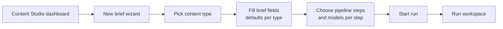
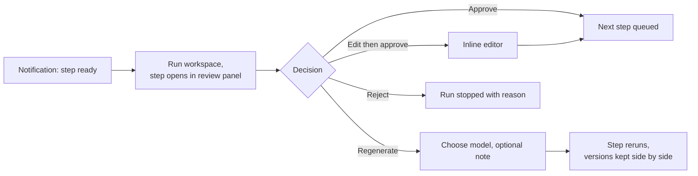

# Content Studio UX

**Status:** M3a in review. Wireframes: [docs/wireframes/content-studio.html](wireframes/content-studio.html) (open in a browser).

**Decided in review (2026-10-13):** brief presets per content type, yes (managed in their own screen, "Save current as preset" in the wizard); site crawl for guest posts as its own pipeline step, yes. Versions kept per step: the first draft plus the last three. Notifications: admin only (a count badge on Content Studio in the sidebar, a message on the next admin page view, and the dashboard review queue); no email or Slack.

The generation system lives **inside the Wagtail admin** as the "Content Studio" area. It uses Wagtail's own admin components (header, side panels, listings, forms, buttons, icons, dialogs, status tags), so it feels like part of Wagtail rather than a bolted-on tool.

## Design principles

1. **You stay in control.** Nothing goes past an approval gate without you. Every AI output can be edited, regenerated or rejected, and the edited version is what moves forward.
2. **Long jobs never block you.** A step can take 20 minutes on a local model. Starting a step returns immediately; progress shows live; you can leave the page and get notified when the step is ready to review.
3. **Show the evidence next to the output.** Grade level per section, keyword placement, accuracy flags and `[VERIFY]` markers sit beside the text they refer to, not on a separate report page.
4. **Choices are explicit, never hidden.** The model used for each step is always visible and changeable from a dropdown. Free and paid models are labelled, and unavailable ones are disabled with the reason.
5. **One brief, one workspace.** Everything about a piece of content (brief, every step's output and history, images, metadata, publish status) is reachable from one run workspace.
6. **Familiar patterns over novelty.** Follow Wagtail's existing interaction patterns (listing filters, side panels, status tags, the action menu) wherever one fits.

## Main user flows

### 1. Create content from a brief

### 2. Review a step

### 3. Pick metadata

Title, meta description and slug options from the draft step appear as a **checklist**. Tick one or more, or use **"Add your own"** to type a custom option, which joins the list. The selection is saved with the run and carried to the published page.

### 4. Publish

Approved content becomes an `ArticlePage` draft and enters Wagtail's own moderation workflow. The run workspace links to the page, and the page links back to its run.

## Screen inventory

| Screen | Purpose | Key elements |
|---|---|---|
| **Studio dashboard** | Overview and entry point | "New brief" button; runs needing your review (top); runs in progress with live status; recent output; host service status (Ollama, ComfyUI) |
| **Brief wizard** | Create a brief in a few short steps | Content-type cards (SEO blog, guest post, lead magnet, pillar, whitepaper); per-type fields with sensible defaults; inline help per field; step and model selection with a recommended preset |
| **Briefs listing** | Find and reuse briefs | Wagtail listing with filters (type, region, status), search, "Start run from brief" |
| **Run workspace** | Where all the work happens | Left: vertical **step timeline** with status tags (queued, running with elapsed time, ready to review, approved, failed). Centre: the selected step's output in a reader/editor view. Right side panel: **checks** (grade per section, keywords, accuracy flags), **model** used with the dropdown to regenerate, step history and versions. |
| **Step review panel** | Decide on one step's output | Approve / Edit & approve / Regenerate / Reject in Wagtail's action-menu style; side-by-side compare of versions; changelog for edit steps |
| **Metadata checklist** | Choose title/meta/slug | Checkbox list with character counts and keyword indicators; "Add your own" input; preview of the search result |
| **Prompt templates** | Maintain prompts | Snippet listing with revisions and diff; which steps use each template |
| **Models and providers** | See what's available | Verified models per provider, free/paid, last check result, default per profile; "Re-check providers" action (runs `ai_smoke`) |
| **Model comparison** | Evaluation results | The tables from `model-eval.md`, plus links to the run outputs |

## States to design for

| State | Treatment |
|---|---|
| Empty | Dashboard with no runs explains the flow in three lines and shows one primary action: "New brief" |
| Queued / running | Status tag plus elapsed time and model name; for local models, an estimated duration from past runs; the page stays usable |
| Long-running | Leaving the page is safe; a Wagtail notification and the dashboard "Needs your review" list bring you back |
| Ready to review | Prominent status, focus moves to the review panel when opened |
| Failed | Plain-language reason (e.g. "Gemini daily free limit reached"), what was tried (retries, fallback), and actions: retry, retry with another model |
| Provider unavailable | Model disabled in dropdowns with the reason (not configured, not free, rate-limited), never silently missing |
| Partial output | Kept and shown with a warning, so a long draft isn't lost when a model stops early |

## Accessibility and usability requirements

- Use Wagtail's components so keyboard navigation, focus states, contrast, dark mode and screen-reader labels match the rest of the admin.
- Every status is shown with text, not colour alone.
- Live updates announce politely (ARIA live region) and never move focus unexpectedly.
- Long outputs are readable: comfortable line length, headings preserved, section anchors from the timeline and checks panel.
- Destructive actions (reject, discard version) ask for confirmation.

## Open questions for the M3a review

1. ~~Presets per content type~~ Decided: yes.
2. ~~Site crawl as its own step~~ Decided: yes.
3. ~~Versions to keep~~ Decided: first draft plus the last three.
4. ~~Notification channels~~ Decided: admin only.
